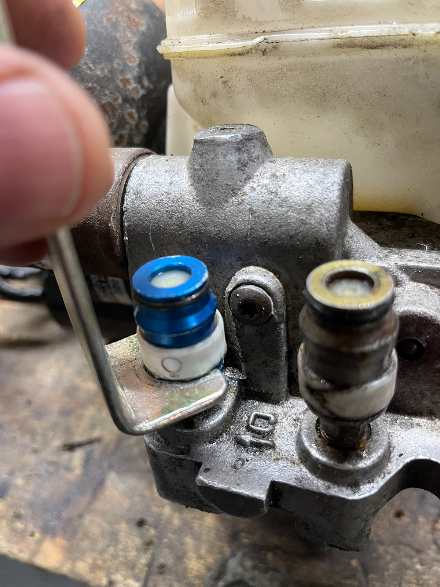
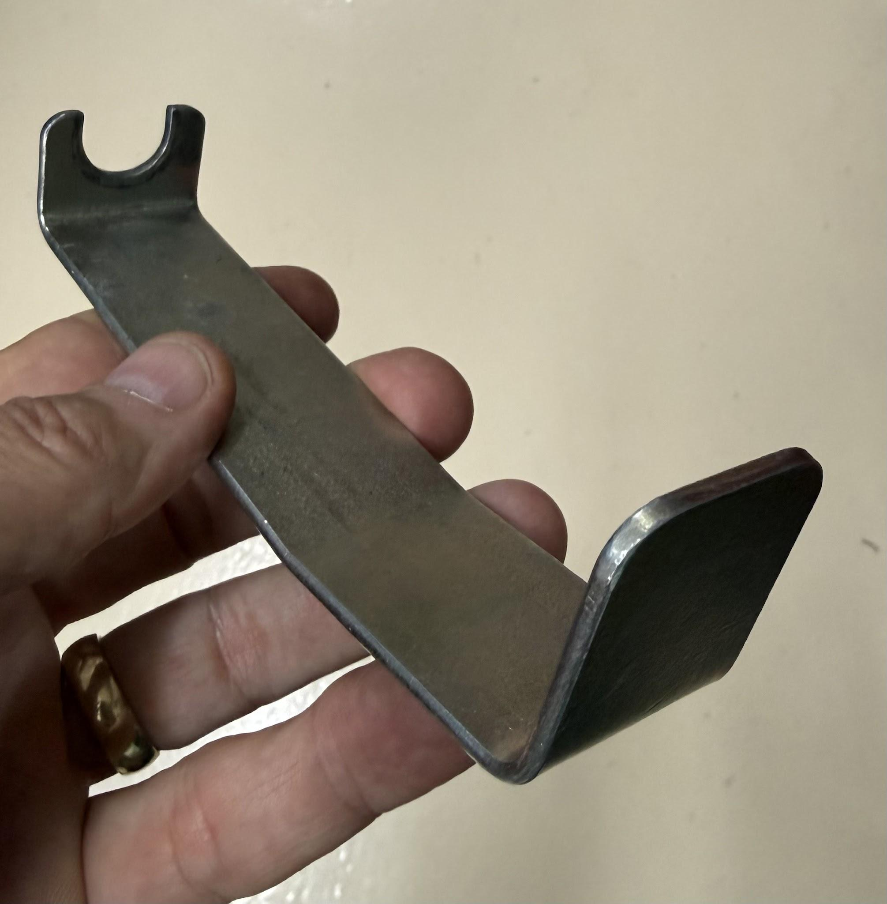
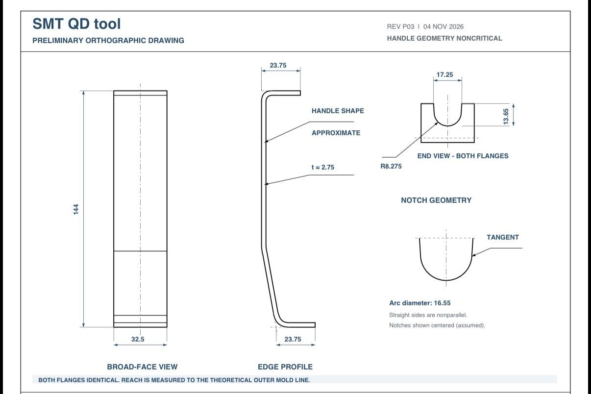
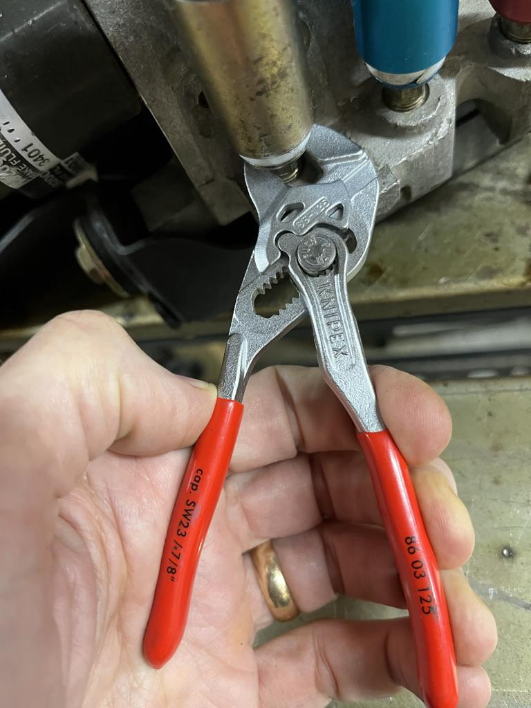

# SMT - Quick Disconnect Hoses

[Return to index](../README.md)

Written by cyclehead21@gmail.com

## Contents

- [Overview](#overview)
- [Screwdriver](#screwdriver)
- [Release collars](#release-collars)
- [Tool](#tool)
- [Releasing the connectors](#releasing-the-connectors)
- [Stuck connectors](#stuck-connectors)
- [Removing the hoses](#removing-the-hoses)

---

## Overview

The HPU has three hydraulic hoses, each with a quick-connect fitting. They are designed to be self-closing so they don’t leak when disconnected. Each fitting has a white teflon ring that you press to unlatch the quick connector.

This tool below was designed by J-Son Chia in Malaysia. It presses uniformly on the soft Teflon ring, and prevents damage to the soft teflon ring when unlatching the high pressure hoses. The handle design allows good access and leverage when the HPU is still installed in the car, or on the workbench.

<https://youtu.be/C9fbl39QYKg>

Alternatively, you can press the white ring using a flat screwdriver.

Flip the whole HPU on its side so the three hydraulic lines are facing up (for better access). The three hydraulic lines are “quick disconnect” joints. They connect very quickly. They are more difficult to dis-connect. Each one has a soft teflon plastic ring. You need to press this ring completely inside, into the connector to unlatch the internal fingers.

Video: <https://youtube.com/shorts/oC_OV4RanMM?feature=share>

Reference: Clutch pressure supply hose is Blue, GSA pressure supply or Master Pressure hose is Gold, and Fluid return hose is Red.

## Screwdriver

You can use a worn flathead screwdriver that doesn’t have any sharp edges. Use the flat surfaces of the screwdriver to press the white ring upward, inside the collar. Don’t bugger up the soft white plastic ring. If you want to really protect the white ring, you can wrap a small zip tie around just beneath the white ring and zip it up tight. Then press your screwdriver against the zip tie as a sacrificial tool. This prevents buggering up the white ring. Cut the zip tie off when you’re done.

## Release collars

The original collars are made from soft white teflon. I designed some replacement collars in Fusion360 and made an STL file. I’ve been printing replacement collars from PETG material. It seems to work pretty well, where the replacement collars aren’t too brittle or too soft. I usually throw the 3D printed collars away after 2-3 uses. They get mangled up, and they’re really cheap. I’ll try to remember to post them on the web - check thingiverse for items by “cyclehead”.

## Tool

Alternatively, you can buy or make a nice tool like this. (.100 inch thick steel, .656 inch wide slot with a full radius.) It will press the white ring uniformly.

All dimensions are in millimeters.

## Releasing the connectors

Press the white ring up inside until it’s hidden from view. You can rotate the whole connector for easy access to the entire perimeter of the white ring. Rotate the connector, push the ring up inside, and walk all the way around each connector. Don’t bother tugging the connector apart until all the white ring is pushed inside, all the way around. When the white ring is all pushed inside, the fingers will be unlatched, and the two halves of the connector will be very easy to pull apart. Sometimes it helps to give the connector a little push in the “closed” direction to give the fingers a little free space to release.

## Stuck connectors

The red and blue connectors are made from anodized aluminum. The gold connector is made from steel so it can rust completely shut if it has been in a corrosive environment. If a connector simply won’t open up, you can unscrew the hose from the HPU body. Be very careful with the tiny wrench flats. They will try to round off. Apply a little PB blaster or your favorite penetrating oil, then tap the flats with a small punch and hammer to loosen. Use a small pair of “Knipex” brand pliers. (They clamp the flats without slipping), or (last resort) a very tight-fitting open end wrench may work. Take pains to avoid rounding off the small flats, the fitting is very soft steel. Don’t go crazy with penetrating oil. All of the rubber parts of the SMT system will swell up and fail if they are soaked with hydraulic oil or petroleum products (grease, motor oil etc)

## Removing the hoses

Press the white teflon ring up inside the red, gold or blue connector to release the fingers. If that fails, these “Knipex” pliers are the very best tool to unscrew the hoses from the HPU - without rounding off the wrench flats. This pair in the photo are 5” pliers - really too small. The 6” or 7 ¼” size of Knipex pliers are the absolute best tools for this job. (Please disregard the colors. Gold fitting goes in the middle!)

[Return to contents](#contents)

[Return to index](../README.md)
